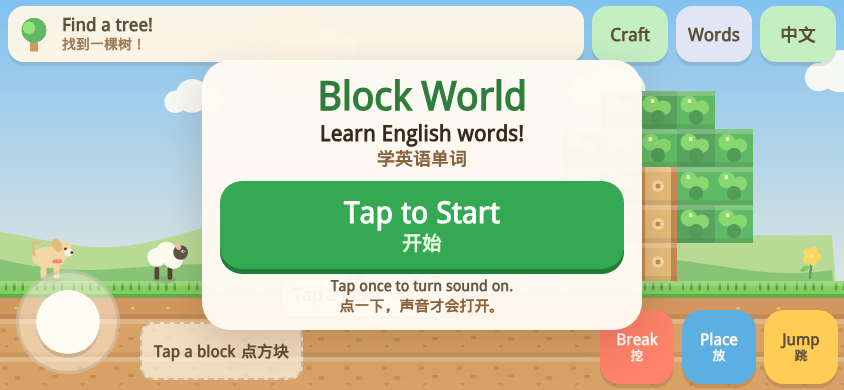
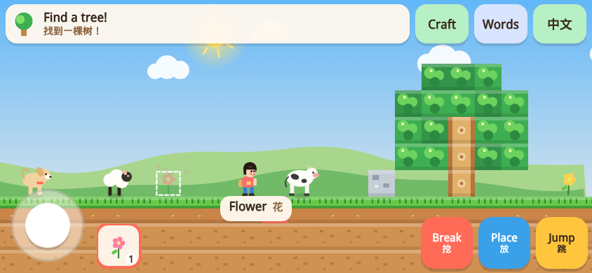
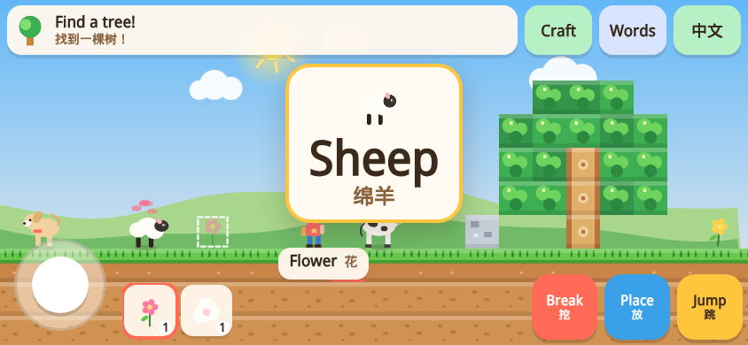

# 杨杨的英语方块世界 Block World

一个给 6 岁小朋友玩的英语学习小游戏：Minecraft 风格的 2D 方块世界，点方块或小动物就会读出英文单词。

**直接玩：** https://jiangmingjie168.github.io/yangyang-game/

- 离线单文件（index.html），没有内购、外链、聊天，也没有怪物和伤害
- 为 iPhone 横屏和 Safari 优化：先点「开始」打开声音
- 进度保存在浏览器本地

